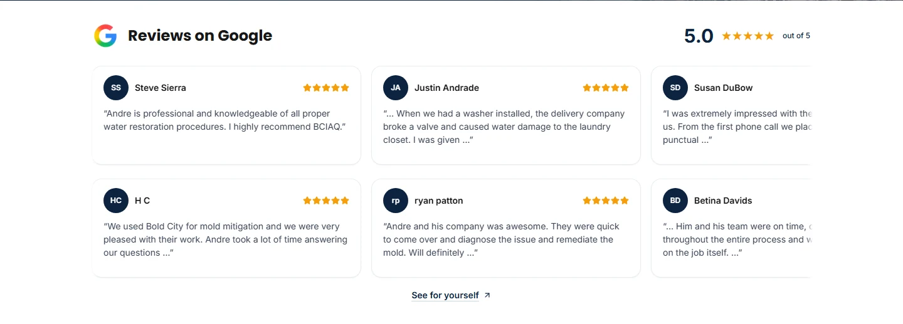
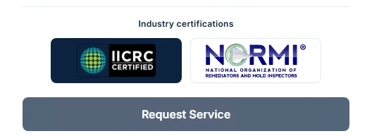
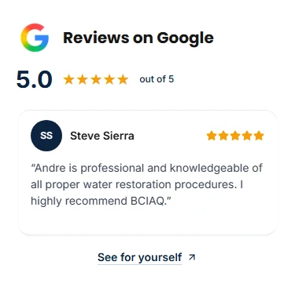

# Review link and conversion-adjacent certifications

November 8, 2026. Focused presentation update to existing draft PR #1, branch `codex/website-seo-revamp`, starting at fetched head `8fe3cc58ea12e990ed07f5597ef6dd73a0ea4d99`.

The owner chose a direct Google link instead of pursuing the reviewer-photo API connection. The carousel keeps its existing initials and approved 22 written reviews. No photo source, portrait, review text, rating or count was added.

## Changes

- Added exactly one **See for yourself** link beneath each shared review-carousel section. It uses the existing verified Google Business Profile URL, `https://www.google.com/maps?cid=13860030253406824266`, where visitors can inspect the business and reviews. It opens in a new tab with noopener/noreferrer, a descriptive accessible label, visible focus outline and a small external-link arrow. No link was added inside individual review cards.
- Added a shared `FormCertifications` component using the existing, unmodified IICRC and NORMI images. White IICRC lettering has a navy backing; NORMI has a white backing. Fixed frames, intrinsic aspect ratios and contain sizing avoid stretched/cropped marks or layout shift.
- Included the proof row immediately above the submit actions in **all five form components**: StandardContactForm, ContactRequestForm, AdContactForm, LeadForm and ModalContactForm. The first three are currently active on `/`, `/contact` and `/ads/emergency-restoration`; LeadForm and ModalContactForm remain available reusable components and were not added to public pages.
- Moved the Contact and emergency landing page's earlier certification images into their form panels. Their earlier Google review imagery and other content remain. About/service/financing certification presentations were outside this form-placement change and remain.
- Limited the modal panel to the viewport with vertical scrolling so its new trust row cannot make the submit controls unreachable on a short screen.
- Updated the existing review pattern and added the form-certification pattern in `ui-registry.md`: navy text, slate borders, rounded-lg image frames, compact spacing and clear keyboard outlines.

No server handler, accepted-lead dispatch, Turnstile verification, recipient routing, form field/validation/submission callback, analytics/deployment/preview configuration, canonical/schema or SEO architecture was changed. No account setting, GTM publication, merge, production deployment, real lead or email was performed.

## Verification

| Check | Result |
| --- | --- |
| `npm test` | **21/21 PASS**; existing provider/Siteverify behavior uses mocks, no real notification |
| `npm run build` including TypeScript | **PASS**, unchanged config with a fresh isolated output directory; 39 generated pages, no temporary fixture route |
| ESLint | **0 errors / 9 existing warnings** |
| Actual development Chrome, five form types × six widths | **30/30 PASS** at 320/375/430/768/1024/1440; both genuine logo assets load, correct backing/contain styling, no page overflow, proof ends 16–24px above submit |
| Short modal | **PASS** at 320×640; submit can be scrolled fully into view |
| Existing focused production-build Chrome suite | **10/10 PASS**: all six review sizes, keyboard, desktop/mobile motion, hover/touch pause/resume, reduced motion, accessible repeats, original records and nonproduction tracking isolation |
| Production-build captures | **6/6 PASS**, three active routes at 375/1440; noindex, no overflow, no contact POST and no production tracking request |
| Google footer link | One per carousel, outside cards, correct existing destination, exact visible text, safe new-tab attributes and visible keyboard focus |

The development form checks mounted reusable LeadForm/ModalContactForm in a temporary development-only route. That route was removed **before the production build**; no fixture page ships. Actual forms were rendered without mocking provider/API success, but the local public widget key was deliberately blank. Buttons therefore remain disabled and local widget-unavailable UI is expected: these are **visual, not genuine lead-delivery tests**. No challenge was completed or form submitted. The 21 unit tests retain their explicit mocked-provider scope.

An initial visual run completed all 30 layout cases but its final network assertion counted automatic Google Maps iframe POSTs as application submits. The monitor was corrected to distinguish same-origin application POSTs, then the complete 30-case run passed. The original report remains in `initial-browser-results.json`; no website security or form behavior was changed to satisfy the check.

[Form results](browser-results.json) · [Production review regressions](production-browser-results.json) · [Clean capture results](capture-results.json) · [Unit output](unit-results.txt) · [Build output](build-results.txt) · [Lint summary](lint-results.json) · [Exact changed files](changed-files.txt).

## Screenshots

Actual local production-build captures. Form images intentionally show only the proof-and-submit region so fixed navigation does not obscure a tall form screenshot. Disabled buttons reflect the local blank-widget QA configuration, not a change to deployed verification behavior.

| View | Review section | Certifications at submit |
| --- | --- | --- |
| Desktop |  |  |
| Mobile |  |  |

[Contact mobile](contact-375.webp) · [Contact desktop](contact-1440.webp) · [Emergency mobile](ads-375.webp) · [Emergency desktop](ads-1440.webp) · [All six review measurements](review-measurements).

## Review outcome

- Plan alignment: PASS — one section-level Google link, certification proof next to every form's conversion action, no new photo integration.
- System integrity: PASS — shared component uses existing assets/design tokens; all security, analytics and SEO behavior stays in its existing owner.
- UI readiness: PASS in actual local development and production-build Chrome. No new browser error, overflow or inaccessible submit was found. Existing unrelated lint/development image warnings remain.

This UI pass is ready for preview review. Existing [operational production/GTM release gates](../release-prep/launch-runbook.md) still require their separately authorized qualification; this focused change does not close them. Final-head hosted preview status is reported in the PR rather than inferred from a previous head.

Plain English: visitors can check the Google reviews themselves. They see the certification badges just before pressing Send, where the badges can help them feel comfortable contacting the team.
