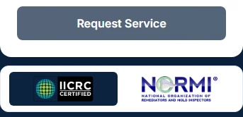
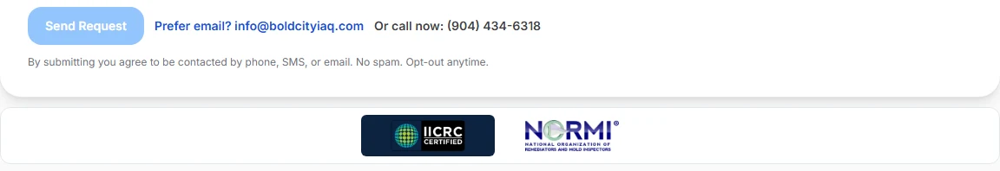
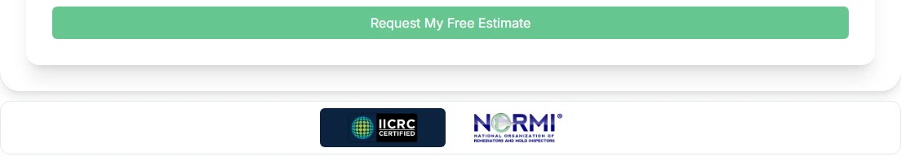
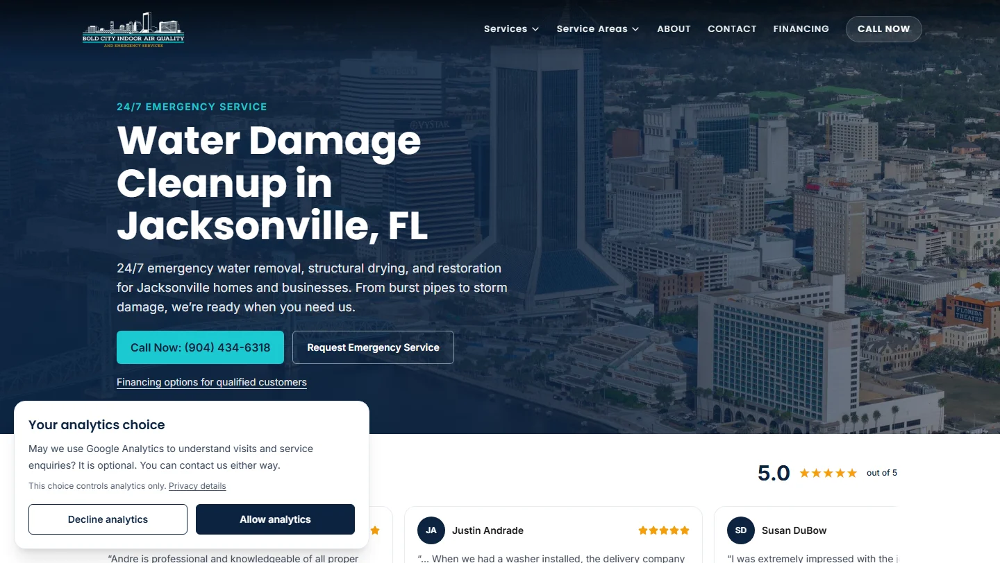

# Final GA4-only readiness — November 9, 2026

**Website GO for preview review; production/GTM publication NO-GO.** Continue [draft PR #1](https://github.com/saybenn/BoldCity2025/pull/1), branch `codex/website-seo-revamp`, from fetched remote/local head `ab2d20429c49ea028860f104522802a503741688`. This is the current checklist; it supersedes historical Ads/photo launch blockers. No merge, production deployment, GTM publication, live GA4 change, secret modification or fresh real lead/email occurred.

## A. Completed

- Certifications are now **outside and directly below the entire form card**, in a compact horizontal mini-band. Active page parents own placement on homepage, Contact and emergency landing page. Reusable Lead/Modal retain sensible card-plus-band wrappers. Existing, unmodified logos; navy IICRC contrast, light NORMI backing; 66px band and 12px gap; no duplicate images or changed form fields/submission behavior. The modal scrolls to both submit and band on a short screen.
- Preserved the Google carousel, “See for yourself” link, genuine gallery, service/local architecture, SEO/schema, analytics event contract and preview protections. Reviewer photos remain optional post-launch work.
- [Source audit](preserved-source-audit.json): **41 existing page/lib/edge/config files**, both logo assets and all five submission callbacks remain unchanged. The API handler exactly matches the one used for the successful genuine preview delivery. The additional owner-approved consent work intentionally changes `_app`, `lib/analytics` and `AnalyticsLifecycle` and adds a privacy page; it does not rebuild the form or change secrets.
- Added the explicitly approved **simple analytics opt-in**: no GTM/GA4 before Allow, no replay of earlier activity, one current-page view when allowed, privacy details and preference controls on every route, 180-day saved choice and blocked-storage fallback. Ads consent stays denied. Declining leaves forms usable; withdrawing an earlier Allow warns about and performs a reload to unload tracking, removing only standard GA cookies. GA4 lead totals intentionally cover consenting accepted enquiries. [Decision/implementation record](analytics-privacy-decision.md).
- Reconfirmed actual live GTM **version 3 / Version 2**, August 28, 2025, and downloaded a fresh published export. Its container version matches the previous immutable backup exactly. Downloaded Default Workspace 4 too: 49 pending changes, identical effective configuration to the November 7 audit except its fingerprint. Full original exports remain private in `.qa-lock/ga4-launch`; public hashes are in the audit.
- Prepared [ga4-only-candidate.json](ga4-only-candidate.json) and [dependency/parameter audit](gtm-candidate-audit.json): **five active GA4 tags, zero active Ads tags**; original published five tags preserved paused with original dependencies; provisional Ads 52/53 and Ads-only settings 54/55 excluded. Current useful parameters, accepted-only trigger, Base `send_page_view:false` and financing/form-type compatibility mappings preserved. Four unused draft service variables omitted. This is an **offline reviewed reference**, not a saved account draft or validated import.
- [Controlled cutover and rollback runbook](launch-runbook.md) now requires GA4 only. [Focused contact/security audit](contact-security-status.md) reuses the genuine prior preview/Postmark delivery and prior edge evidence with their precise limits.

## B. Verification results

| Check | Result / evidence |
| --- | --- |
| Production build, including TypeScript | **PASS** after consent; 40 generated pages including `/privacy`, no temporary QA route. [Output](build-consent-results.txt) |
| Standalone TypeScript | **PASS** after consent. [Output](typecheck-consent-results.txt) |
| ESLint | **0 errors / 9 existing warnings** after consent; later modified consent/test files also pass targeted ESLint. [Summary](lint-consent-results.json) |
| Unit tests | **25/25 PASS** after consent, including storage expiry/fail-closed behavior, advertising denial, single-reload cross-tab withdrawal and dropped pre-consent events, plus mocked Siteverify/recipient/accepted-only contracts. [Output](unit-consent-results.txt). An old timing rejection fixture created its timestamp before compilation; a deterministic injected test clock fixes that test-only race without changing the handler. |
| Mini-band matrix | **30/30 PASS**, five form components × 320/375/430/768/1024/1440. Outside form/card, 66px height, 12px gap, correct loaded logos, no overflow/duplicates. Short 320×640 modal also passes. [Results](mini-bands/browser-results.json) |
| Full browser regressions | Final rebuilt run: **30 PASS, one optional avatar fixture skipped**. [Final result](browser-final-results.json). Existing event regressions explicitly use a saved Allow; dedicated consent tests start as fresh visitors. Earlier reports retain two selector failures: homepage-only header on Contact, then a hidden scrolling navbar after visiting footer controls. The visible footer phone selector fixes the test without changing navigation. A real cross-tab duplicate-reload issue was then found and fixed by sharing one storage listener; final unit/browser checks cover it. |
| Route/schema/image scan | **37 existing routes / 28 assets / zero issues** after consent, plus the new linked privacy page returns/rendered correctly. [Report](site-consent/site-validation.json), [matrix](site-consent/page-matrix.md) |
| Isolated GTM QA | After explicit Allow, actual Chrome with GTM blocked and real public GTM HTTP 200 both emit page_view 1 initial / 2 after navigation, phone 1, CTA 1, lead 0. Before Allow, script and app events are absent. **Zero collectors past CSP**. [Result](gtm-consent/local-browser.json). This loads the public container, not the proposed unpublished candidate, and does not prove GA4 receipt. |
| Consent UI/integration | **Six widths PASS**, no overflow; fresh suppression, no historical event replay, saved Allow one current view, withdrawal unload across both tabs and GA-cookie removal with unrelated cookie preserved. [Actual local QA result](consent-local/browser-results.json). Declined form acceptance is mocked in the dedicated browser regression. |
| Offline GTM reference | Five active GA4 tags, preserved parameter maps, legacy tags paused, exact custom-event filters, no dangling references. Explicit trigger model produces no lead from generic form/history. It cannot disable Google's remote history measurement or prove actual tag firing. [Audit](gtm-candidate-audit.json) |

Full browser form flows mock Turnstile/API success/error responses. The local-only build uses Cloudflare's official public dummy sitekey, separate from GTM QA's blank-widget profile. Local mail configuration deliberately fails closed as a second safeguard. No production widget authorization, private secret, environment file or verification behavior was changed. No genuine lead or GA4 delivery is inferred. The reusable-form fixture was development-only and removed before build. Native production form behavior is not weakened for testing.

### Screenshots

Actual selected-preview Chrome form-and-band captures from application commit `d0c8aaf`. No human challenge or form submission was performed; disabled buttons reflect the uncompleted widget, not a behavior change. Local reusable-form captures remain in `mini-bands`.

| Desktop | Mobile |
| --- | --- |
|  |  |
|  |  |
|  |  |

Both Netlify checks **PASS at application head `d0c8aaf`**. [CI evidence](ci-application-head.json). Selected-preview checks: **24 route/width cases PASS** (home, Contact, emergency, all six services, representative areas and privacy), **18/18 active-form/six-width cases PASS**, six-width consent UI/persistence checks PASS, **37 existing routes / 28 assets / zero SEO issues**. Gallery, mobile navigation, Google link/reviews, preview noindex and no overflow pass. Even a saved Allow produces **zero GTM/GA4 requests** on the preview. No application form submissions occurred. Production was only read using HTML/JavaScript GET; both production and preview expose the previously approved public widget key, which does not establish private secret pairing.

[Hosted route/navigation/review report](hosted/browser-results.json) · [Mini-band matrix](hosted-mini-bands/browser-results.json) · [Consent report](hosted-consent/browser-results.json) · [Hosted SEO scan](site-hosted/site-validation.json) · [Exact changed files](changed-files.txt).

Netlify's injected Drawer intercepted the initial pointer click on the bottom Analytics choices button in the hosted preview. Normal **keyboard focus + Enter** verified that control; local tests exercise pointer activation, and no site code was changed to work around the toolbar. The initial hosted obstruction report is retained. This is a preview qualification limit, not a diagnosed production form failure. [Netlify deploy/Drawer context](https://docs.netlify.com/deploy/deploy-overview/).

| Consent desktop | Consent mobile |
| --- | --- |
|  |  |

Final evidence-only head statuses are reported in the PR/final handoff; the application source is unchanged from the tested application head.

## C. Remaining actual launch requirements

1. **Save/re-export the reviewed GA4-only account configuration and complete account verification.** Computer Use ended at Windows' URL-confidence guard after Chrome Find opened. No new GTM draft edit was saved; current Default Workspace 4 still has its 49 historical changes and provisional Ads additions. A fresh unpublished Tag Assistant connection, actual GA4 key-event/Create/Modify-event/filter inspection, current Netlify rollback/config/edge reconfirmation and final saved-version review remain. Close Find and leave the GTM tab with its URL visible for a resumed account session; no credentials or security-setting change is requested. Do not repeatedly retry the blocked operation or publish the existing workspace as-is.
2. **Qualify the chosen opt-in in the saved GA4-only account draft.** The owner selected and the website now implements basic analytics opt-in. Local suppression/withdrawal tests pass; confirm the actual Google consent ordering/state and no automatically manufactured form conversions in the unpublished workspace. A missing banner is not being asserted as a universal legal failure, and a paid CMP is not required by this plan. Review the prepared privacy wording with the release artifact. [Decision record](analytics-privacy-decision.md).
3. **Complete coordinated measurement/production acceptance with explicit authorization.** The known 3-versus-2 history attribution persists until the approved cutover switch; the plan is prepared, not executed. Genuine accepted-once/replay/GA4 receipt were not captured in the prior successful preview session. Reuse that existing delivery evidence; inspect its surviving session first. If a new test is needed, combine checks in one separately authorized release inquiry with exact environment/recipient, rather than repeatedly sending preview emails. No new test permission or release permission is assumed.

The contact pipeline is working based on genuine prior delivery and unchanged code, with fresh isolated regressions. Production secret pairing/routing and current edge attachment are release preflight/acceptance checks, not diagnosed form failures. **Ads account activation, campaign settings, Ads attribution and unavailable reviewer photos are not blockers.**

## D. Cutover and rollback

The [exact runbook](launch-runbook.md) orders: actual active Netlify deploy + published GTM backups → approved SHA/configuration and owner checkpoint → website deployment → GA4 automatic-history OFF in both mirrored controls → reviewed GA4-only GTM publication → clean Tag Assistant/DebugView → one separately authorized genuine inquiry/replay/delivery check → monitoring. It identifies the non-atomic interval and old-tab propagation. The recommended rollback pauses all measurement while preserving its configuration, keeps the new consent gate where possible, and restores the recorded Netlify deploy only if needed. Restoring old GTM version 3/history behavior requires explicit review of its legacy Ads/consent differences. [All-paused offline reference](rollback-measurement-paused.json). No fabricated backfill or automatic resubmission.

Plain English: the badges now sit in a small strip below each form. The working message system stays the same. The website checks pass, but the Google tracking draft still needs to be saved and checked in the account before launch. Ads and reviewer pictures can wait.
