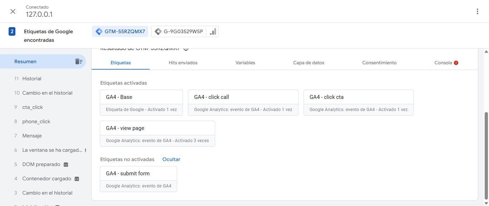

# Local GTM QA correction — November 7, 2026

Existing draft PR #1, branch `codex/website-seo-revamp`, starting from verified remote head `0ab65d2fb3031f067ae3ce9e6f1b4f36258d3860`. No GTM configuration was edited/published, PR merged, production deployed, production widget changed or lead/email submitted in this pass.

[Exact changed-file manifest](changed-files.txt) · [Validation summary](validation-summary.json). Runtime changes are confined to `_app.tsx`, `lib/deployment.mjs`, `lib/gtm-qa.mjs` and `next.config.mjs`; the remaining changes are the explicit QA launcher, checks, test/build ignores, scripts entry, documentation and evidence.

## Diagnosis and implementation

The prior `_app.tsx` guard allowed GTM only with **production deployment context plus `boldcityiaq.com` or `www.boldcityiaq.com`**. Consequently localhost and both Netlify previews intentionally had no GTM bootstrap for Tag Assistant to discover. Debug cookies/query parameters could not override that guard.

`AnalyticsLifecycle.tsx` is mounted independently of GTM. It uses `lib/analytics.ts` to queue standard events in `window.dataLayer`; no GTM installation is needed for that queue. Real main-page Chrome checks found no missing `page_view`, `phone_click` or `cta_click`, so neither event module was changed. These results do not settle the previous real preview submission's unverified accepted-lead count.

The explicit opt-in is `NEXT_PUBLIC_GTM_QA_ENABLED=true`. `localGtmQaAllowed()` requires **all** of:

- `NODE_ENV === "development"`;
- exact flag string `"true"`;
- deployment context and provider both `"local"`;
- browser hostname exactly `localhost` or `127.0.0.1`.

Production/preview/branch/unknown contexts, other providers, lookalike hosts, IPv6 and `0.0.0.0` do not qualify. The original production-host restriction remains. A deliberate production build with the flag set still suppressed GTM on loopback. Normal development with the flag off also suppressed it.

`next.config.mjs` adds a **hostname-matched response CSP only for local development QA**. The response marker is `X-GTM-QA: localhost-diagnostics-collection-blocked`. GTM/bootstrap/debug scripts and Tag Assistant may run; GA4/Ads/Floodlight collectors, external pixels and GTM service-worker collection frames are excluded. Header matching is anchored and checked with raw HTTP Host headers, including lookalike-host rejection. No production or Netlify preview CSP was relaxed. Existing noindex behavior remains.

The policy is applied as a response header, covering statically optimized pages before any JavaScript executes. `_document.js` retains its original implementation. The policy's inline/eval allowances are limited to the Next development runtime; this is not a production CSP template.

In the explicit QA profile only, telephone clicks still reach AnalyticsLifecycle but cannot launch a phone application; submit events are prevented before form handlers. The launcher blanks the real widget's public key only in its child process. Normal development, production and preview website/form behavior retain their existing paths.

## Safe unpublished-workspace procedure

1. Run `npm run dev:gtm-qa`. It binds **127.0.0.1:3100**, uses an isolated build directory, explicitly opts in and leaves `.env` files/account settings untouched. Open `http://127.0.0.1:3100/` and confirm the QA response marker and CSP before testing. A `NEXT_PUBLIC_*` environment change requires restarting Next; it is not a runtime URL toggle.
2. In GTM select **GTM-55RZQMX7 → Default Workspace / 4 → Preview**. Enter that exact loopback URL and connect. Use the workspace's Preview entry point; a generic Add domain connection alone does not establish that the unpublished workspace is selected. Google documents this workflow in [Preview and debug containers](https://support.google.com/tagmanager/answer/6107056?hl=en).
3. Confirm Tag Assistant says **Connected**, identifies `GTM-55RZQMX7` and labels the container version **Preview**. Start a fresh session after code/config hot refreshes, which can add development page activity. Keep the website and debugger windows open while testing.
4. Click the navbar telephone link once, then Contact once. No phone app or lead delivery should occur in this QA profile. Inspect the corresponding events, trigger conditions and variable values in Tag Assistant. Do not fabricate a `generate_lead` to claim accepted-form testing.
5. Expect blocked collection/CSP notices. Do **not** remove the policy or allow every blocked domain to silence them. Google lists the distinct [CSP requirements for GTM Preview, Analytics and Ads](https://developers.google.com/tag-platform/security/guides/csp?hl=en); this profile intentionally permits debugging while denying collection. “Completed” tags or “Hits sent” in the debugger are not evidence that GA4 received anything.
6. Stop only this loopback debugging session and the QA server afterward. The existing unrelated localhost:3000 debug session was left untouched during this pass. Nothing is published by using Preview.

For **actual GA4 delivery testing**, use a separate test GA4 **property**, preferably with a separate QA GTM container containing only approved test tags. Point Base and every event tag to the test measurement ID, remove production Ads labels/destination links, and audit the imported configuration before enabling collection in a separately reviewed test profile. A second stream in the production property still contaminates that property; `debug_mode` is not a collection firewall. No test destination was invented or created here, and the current diagnostic profile deliberately offers no switch to permit production collection. Existing `NEXT_PUBLIC_GTM_ID` can select a separately approved QA container while the local collection block remains in place.

## Directly verified results

| Scope | Result | Evidence / limitation |
| --- | --- | --- |
| Website, GTM deliberately blocked | Initial page_view 1; after one route change total 2; phone_click 1; cta_click 1; generate_lead 0 | Real development Chrome/main-page state, no form submission; [local browser report](local-browser.json) |
| Website, real GTM script loaded | Same website-owned counts; real gtm.js returned 200 | Default script is the published container until workspace Preview overrides it; no mock GTM response |
| Normal development flag off | Same website-owned counts; no GTM script/response | [Flag-off browser report](off-browser.json) |
| Production build with QA flag set | Same website-owned counts on loopback; no GTM script/QA response marker | [Production browser report](production-browser.json); confirms the dev exception cannot activate in next build/start |
| Collector isolation | Actual and probe GA4/Ads requests blocked by CSP; no collector passed the routing safety belt; pixel and service-worker frame probes blocked | Route-abort fallback prevents a failed probe from transmitting. Assertions require CSP to block **before** that fallback is reached |
| Tag Assistant | Connected to the real unpublished workspace on loopback | [Observed debugger results](tag-assistant.json), [capture](tag-assistant-final-summary.jpg) |

Tag Assistant's final stable session showed:

| Draft tag | Observed firing count |
| --- | --- |
| GA4 - Base | 1 |
| GA4 - click call | 1 |
| GA4 - click cta | 1 |
| GA4 - view page | **3 — additional history-associated activity remains unresolved** |
| GA4 - submit form | 0; no lead submitted |

Initially Base and the page-view tag each showed 1. After the telephone click and Contact navigation, the page-view tag's firing list included history messages, including `gtm.historyChange-v2`; the current Event variable showed that value while the exported CE trigger still matched `page_view`. The cause was not established. This is **not** a passing once-per-navigation account qualification and must be reconciled with GA4 enhanced/history measurement and the preview configuration before publication. Do not infer the account's aggregate firing count from the application's independently verified data-layer count. An earlier hot-refresh session also accumulated extra activity; it is not used as a clean counting test.

No real GA4 delivery or accepted-lead event count is claimed. No new test lead was sent; the previously delivered preview notification remains historical evidence in the prior phase report.

## Published-container comparison and deletion gate

The actual GTM Versions UI identified **published version 3, “Version 2,” published August 28, 2025**. Its export was downloaded and compared against a fresh export of workspace 4. The workspace's tags/triggers/variables match the previously verified unpublished export. Full backups remain local/ignored; [the public comparison](published-comparison.json) records hashes, IDs, types, references and risks without preview authorization URLs.

All five published tags are absent by ID in the current draft; there are also four deleted published triggers and four deleted published variables. The earlier migration manifest's preservation statement applied to the **existing draft**, not production parity, and is now explicitly qualified with this audit.

| Published item deleted | Draft replacement / risk |
| --- | --- |
| Google Ads Conversion Tracking / 10 | **HIGH: no Ads tag replacement exists.** It currently listens to generic `form_submit`. Choose a retargeted accepted-lead Ads path or a verified GA4 import; audit primary/secondary conversion counting before approving deletion. Do not silently restore generic-submit counting or assume an import exists |
| Google Tag G-9G03529W5P / 16 | Base / 41 retains destination and initialization, adds send_page_view:false. Verify linked settings/consent and automatic measurement parity |
| GA4 - Config / 17 | Despite its name, the published type is a **GA4 event** named `GA4 - Config` on All Pages, not a second true Google base tag. Deleting it removes that custom event; Base / 41 handles initialization. Check reports that consume the legacy event |
| generate_lead / 8 | Replaced by accepted-only GA4 - submit form / 46. The old generic form_submit trigger changes, and old `form_type`/`financing_interest` dimensions are not mapped by the replacement. Confirm reporting consumers |
| GA4 - page_view (custom) / 19 | Replaced by standard page_view / 45. Old `pageview` trigger and raw URL/referrer mappings change; resolve the observed history activity and automatic pageview settings |

Deleted History Change and Page View triggers have no tag references in the published export; Form Submit and Pageview (custom) have the references listed in the comparison. Deleted variables are `page_view variables`, `formType`, `financingInterest` and `phone_number`. Their replacement/dimension semantics need review as part of the complete pending workspace, not just the four standardized event names.

## Turnstile stays separate

`node scripts/check-turnstile-dev-keys.cjs` runs a separate loopback fixture with Cloudflare's **official public dummy sitekey and dummy pass/fail/forced-spent keys**. It uses the real widget/Siteverify service, with no application contact API, Postmark, GTM or production credentials. The three expected responses passed: success, invalid-input-response, timeout-or-duplicate. [Sanitized results](turnstile-test-keys.json).

Cloudflare's [official testing guidance](https://developers.cloudflare.com/turnstile/troubleshooting/testing/) explains that test success returns hostname `example.com` and no action/cdata. It therefore cannot qualify this application's real hostname/action-bound lead acceptance. The existing server checks remain unchanged and must continue rejecting mismatches; do not relax them to make dummy success look like a production integration pass. The forced-spent dummy key tests that response path, not genuine real-token reuse. Production widget authorization was not expanded to localhost.

## Release decision

Validation: production build and standalone TypeScript pass; **18 unit tests pass**; full ESLint has **0 errors / 9 existing warnings**. The existing 10-case Chrome regression suite verifies responsive layout, navigation, event dispatch, attribution and normal accepted/rejected form behavior. Form-provider/API responses in those regressions are mocked, with no emails. Final results are in [the browser report](browser-regressions.json) and [the focused startup retry](browser-retry.json).

The first regression setup compiled an empty widget key, which correctly disabled forms and prevented three mocked form cases from running; that run also had a menu timeout. The isolated test artifact was rebuilt with Cloudflare's public dummy sitekey, without changing environment files or deployed keys. The corrected run passed nine cases; the first 375px navigation raced server startup and returned ERR_CONNECTION_REFUSED, so only that case was rerun after readiness. Original reports are retained; no application logic or test threshold was changed to hide those setup failures. [Build](build-results.txt), [unit output](unit-results.txt), [TypeScript](typecheck-results.txt), [lint](lint-results.json), [initial setup report](initial-browser-regressions.json).

**GO for isolated localhost diagnostics; NO-GO for GTM publication or production release.** Resolve the unreplaced Ads deletion, changed reporting dimensions, observed extra history-associated page-view activity, GA4 enhanced measurements, consent and conversion-import deduplication. Genuine accepted-lead count/replay verification remains outside this no-submission pass. The application's previous SEO, schema, reviews, gallery, recipient and security work is retained.

Plain English: the website already puts click notes in its own notebook. The robot that sends those notes to Google was turned off for practice pages on purpose. There is now a safe practice switch: we can watch tags work while the door to real reporting stays shut. Some old tags would be removed, and an extra page-view needs checking before publishing.
