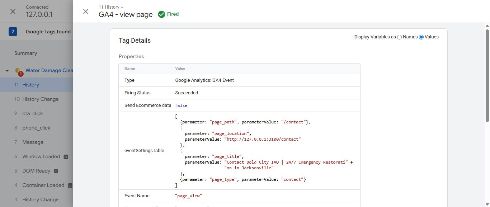
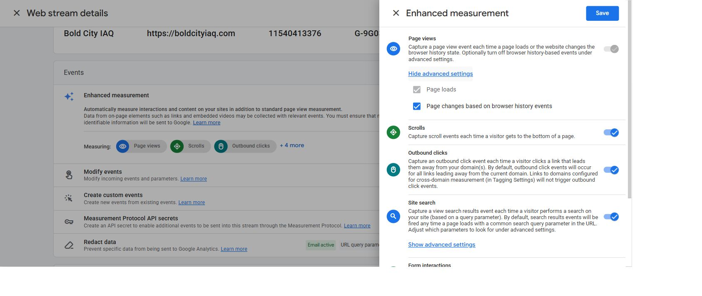
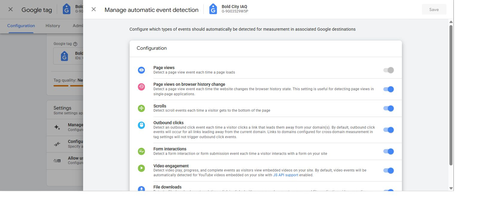
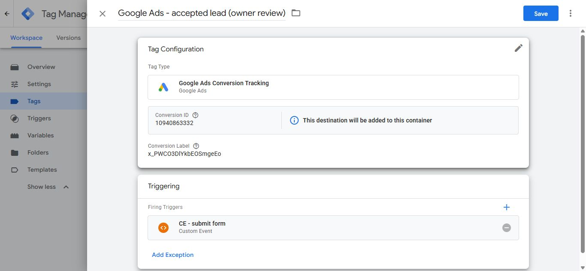

# GTM publication investigation — November 7, 2026

**NO-GO for publication.** The duplicate is reproducible, its additional producer is identified, and draft Ads/reporting corrections are saved. The final clean account test still fails the pageview acceptance criterion. The owner explicitly chose **“Keep live setting; document release blocker.”** The live GA4 history setting stays enabled; its change is deferred to a separately approved, coordinated release. No GTM publication, merge, production deployment, live GA4 setting change or form submission occurred.

Website tested: `b566e149d43201a3d5ba44baa10825dfdca2340c`, branch `codex/website-seo-revamp`, [draft PR #1](https://github.com/saybenn/BoldCity2025/pull/1). This commit adds evidence/documentation only. The running website and all form, SEO, preview, security and analytics code remain identical to that head.

Account scope: `GTM-55RZQMX7`, workspace **4 / Default Workspace**. Production remains **version 3**, named **Version 2**, published August 28, 2025. GA4 property `498306573`, web stream `11540413376`, measurement ID `G-9G03529W5P`.

## Three pageview attributions from two app events

Ran `npm run dev:gtm-qa` at `http://127.0.0.1:3100/`. Connected through the workspace's actual Preview button. Used a fresh connection for the final run, with one initial load, one navbar phone click and one navbar Contact click/client navigation. No source edits, hot refresh, extra navigation or form submission occurred during either clean sequence.

| Phase | Tag Assistant message | `gtm.uniqueEventId` | Raw API event | URL | Debugger attribution |
| --- | --- | --- | --- | --- | --- |
| Baseline initial | 3, displayed “History Change” | 3 | `page_view` | `http://127.0.0.1:3100/` | GA4 - view page / 45, CE - view page / 37 |
| Baseline navigation | 10, displayed “History Change” | 16 | `page_view` | `http://127.0.0.1:3100/contact` | Same tag/trigger |
| Baseline additional | 11, displayed “History” | 17 | `gtm.historyChange-v2` | `http://127.0.0.1:3100/contact` | Same tag; outgoing event name `page_view` |
| Final initial | 3, displayed “History Change” | 3 | `page_view` | `http://127.0.0.1:3100/` | GA4 - view page / 45, CE - view page / 37 |
| Final navigation | 11, displayed “History Change” | 18 | `page_view` | `http://127.0.0.1:3100/contact` | Same tag/trigger |
| Final additional | 12, displayed “History” | 19 | `gtm.historyChange-v2` | `http://127.0.0.1:3100/contact` | Same tag; outgoing event name `page_view` |

The left-hand display label is insufficient evidence of an event's name: the two **application `page_view` pushes are labeled “History Change” by this Tag Assistant UI**. Read the API Call and data-layer model. The additional message really is `gtm.historyChange-v2`, with `historyChangeSource: "pushState"`, new Next.js history state `/contact`, and `newUrl` pointing to `/contact`. Its old URL contains only the diagnostic `gtm_debug` parameter; application event URLs omit it.

The debugger explicitly lists all three messages under **Messages Where This Tag Fired**. The extra message's tag details report event name `page_view`, destination `G-9G03529W5P`, and `CE - view page` with `page_view equals page_view` in the internal measurement context. The selected raw message and its built-in Event variable are `gtm.historyChange-v2`. This is evidence of an automatically produced pageview attributed to the tag, not evidence that the site's custom-event trigger has a history regex or that AnalyticsLifecycle pushed a third `page_view`.

[Full trace, IDs and tag configuration](event-trace.json), [baseline firing index](three-firing-index.txt), [history tag details](history-tag-details.txt), [raw final history model](final-history-event.txt), [raw final route model](final-route-event.txt), [raw final initial model](final-initial-event.txt).

The shared page tag is type `gaawe`, event name `page_view`, **ONCE_PER_EVENT**, with only firing trigger 37, exact Custom Event `_event equals page_view`. It passes `page_path`, `page_location`, `page_title`, and `page_type` from the existing data-layer variables. No history trigger was added to it. Base / 41 fires once on Initialization, with `send_page_view:false`. This suppresses its initial automatic pageview, accounting for the correct initial count of one; it does not disable history measurement.

Initial model: path `/`, type `home`, title “Water Damage Cleanup Jacksonville, FL | Bold City IAQ”. Navigation and additional-history models: path `/contact`, type `contact`, title “Contact Bold City IAQ | 24/7 Emergency Restoration in Jacksonville”. Both resolve the outgoing location to the actual HTTP localhost origin with port 3100. The inherited Base default `https://127.0.0.1/` lacks the QA port, but explicit event parameters override it; that default was preserved.

The history model also retains preceding CTA/phone context. That is GTM's persistent data-layer model, not another user click. See the complete model files rather than interpreting retained values as new events.

## Exact automatic measurement settings

Read the actual Bold City stream and its Google tag, without saving changes:

| Surface | Observed | Required for the explicit AnalyticsLifecycle pageview plan |
| --- | --- | --- |
| GTM Base / 41 | `send_page_view:false` | Keep false |
| GA4 → Admin → Data streams → Bold City IAQ → Enhanced measurement gear → Page views → Show advanced settings | Page loads checked/disabled; **Page changes based on browser history events checked** | Uncheck only browser-history changes at the coordinated cutover |
| Stream → Configure tag settings → Manage automatic event detection | **Page views on browser history change on** | Confirm this is off as well; verify the effective/mirrored state after changing the GA4 control |
| Existing page event / 45 | Explicit `page_view`, strict custom event, once per event | Keep unchanged |

Do not disable all Enhanced Measurement, change unrelated scroll/outbound/video/file/form settings, broaden the custom-event trigger, or remove the working application event to conceal the extra producer. The app should own initial load and completed route pageviews consistently.

Google documents that Enhanced Measurement history pageviews continue even with `send_page_view:false`: [Measure pageviews](https://developers.google.com/analytics/devguides/collection/ga4/views?hl=en). Its [SPA guidance](https://developers.google.com/analytics/devguides/collection/ga4/single-page-applications?implementation=browser-history) explains choosing a consistent pageview source. [Google tag settings](https://support.google.com/tagmanager/answer/12131703?hl=en) describes automatic event detection and destination scope.

**Owner decision: keep the live setting enabled and document the release blocker.** The earlier approval question is resolved; no live change is authorized now. This setting takes effect immediately for production, independently of publishing GTM. Disabling it before the explicit application tracking is deployed could remove route tracking from the current production implementation. Defer the switch and the passing clean retest to the eventual, separately approved website/GTM cutover. This task grants no permission to perform that release.

The new optimized Ads destination has its own draft automatic-history setting, now false. GTM shows that workspace setting applies to **one of two destinations**, Ads only; the existing GA4 destination is unoptimized and still uses the settings above. The final test confirms that changing the Ads draft setting does not cure the GA4 duplicate. No GA4 destination migration/optimization was attempted.

## Published Ads conversion path and draft replacement

Compared the **actual published version 3 export**, not just the workspace. Live version 3 was reconfirmed after the draft edits. Private complete exports stay in ignored local storage; their hashes and the reviewed subset are in [workspace-audit.json](workspace-audit.json).

| Item | Published | Current unpublished draft |
| --- | --- | --- |
| Conversion tag | Google Ads Conversion Tracking / 10 | Original remains marked deleted; **Google Ads - accepted lead (owner review) / 52** is its provisional replacement |
| Type | `awct` | Same |
| Conversion ID | `10940863332` | Same |
| Conversion label | `x_PWCO3DlYkbEOSmgeEo` | Same |
| Trigger | Form Submit / 7, generic `form_submit` | CE - submit form / 40, explicit accepted `generate_lead` |
| Firing option | Once per event | Same |
| Conversion linking | Enabled | Same |
| Product/new-customer/shipping data | Disabled | Same |
| Restricted data processing / consent configuration | `rdp:false`, `NOT_SET` | Preserved; no consent-policy decision implied |

These conversion identifiers are public tag configuration, not login credentials. No secret, auth token or unpublished preview authorization is included here.

Saving the native conversion template caused GTM to add **Google Ads AW-10940863332 / 53**, type `dest_aw`, on Initialization, plus two destination settings. This behavior is recorded rather than hidden:

- New Ads automatic-history setting / 54 is **false**; other automatic event categories retain their generated defaults.
- New user-provided data capability / 55 is **disabled**. Google initially generated automatic email/phone/name/address detection as enabled; that new capability was switched off before the final test. No enhanced-conversion/customer-data collection was introduced.
- The default `ignoreDupeGtagConfigCalls:false` and helper destination require owner review together with existing Ads/account setup before publication.

No Ads account goal, primary/secondary setting, bidding, billing, account link, or campaign was edited. The accessible manager has **no linked client accounts** under its active/draft account view. Another accessible account was labeled cancelled and was not assumed to be Bold City's conversion owner. The conversion ID is not a customer account number, so ownership cannot be inferred from it.

The actual GA4 property has **zero Google Ads links**. Therefore a working GA4-import replacement is **not established**. The intended default is to retain the native Ads conversion through accepted-only tag 52, subject to verification in the conversion's owning account. This is a reviewable draft, not a verified replacement decision or authorization to publish the original deletion.

The owner must verify the owning account/conversion action, label, current primary/secondary status, campaign goal dependencies, counting setting and attribution/linking requirements. If choosing GA4 import instead, first establish the correct GA4–Ads link and imported accepted `generate_lead` action, then choose one primary counting path. Do not let both direct and imported actions count the same lead as primary. A GA4 import is not identical to a native Ads action; verify feature/attribution implications rather than assuming parity. See Google's [GA4 import guidance](https://support.google.com/google-ads/answer/2375435?hl=en-en) and [conversion action guidance](https://support.google.com/google-ads/answer/10632359?hl=en-GB).

An attempted per-tag restoration was rejected by automatic approval review because the confirmation dialog described reverting all unpublished workspace changes. It was canceled. The safer, separately named new tag preserves every existing workspace item; the export comparison verifies this. No rejected action was retried or performed indirectly.

## Legacy reporting dimensions

The published `generate_lead` / 8 passes `form_type → {{formType}}` and `financing_interest → {{financingInterest}}` on generic `form_submit`. The original draft replacement / 46 dropped both parameters. The current draft preserves their useful business meanings without modifying any website/form code:

- **Compat - form_type / 56** maps the current form IDs to `standard`, `ad`, `lead`, or `modal`. ContactRequestForm and StandardContactForm both map to `standard`.
- **Compat - financing intent / 57** maps only four explicit current Standard/Ad financing intent strings to `yes` / `no`.
- **Compat - financing_interest / 58** gates that lookup to StandardContactForm and AdContactForm. Other forms or unknown values return undefined, omitting the parameter rather than inventing “no” or leaking a previous form's financing answer.
- GA4 accepted-lead tag / 46 adds both parameters and preserves its existing six mappings, destination, trigger and firing settings.

The actual GA4 Custom definitions table has **0 registered custom dimensions**. Its audience inventory contains only All Users and Purchasers; no saved exploration was listed in the accessible Explore view. No dependency on these fields was found in those surfaces. That is not a complete audit of private explorations, external Looker dashboards, exports or other reporting consumers. Preserving the parameter contract avoids silently retiring useful reporting. New custom dimension registrations, if wanted, are an owner reporting choice; none were created or deleted.

[Nine offline exported-lookup cases](lookup-contract-check.json) pass, including stale-financing context on LeadForm/ModalContactForm, unknown forms, and missing intent. This is configuration contract validation, **not a real accepted submission or GA4 receipt test**.

## Verification and remaining release gates

| Check | Result | Scope |
| --- | --- | --- |
| Website independent events | PASS | Real Chrome, GTM explicitly blocked: initial pageview 1, total 2 after navigation, phone 1, CTA 1, lead 0 |
| Website events with real GTM | PASS | Real Chrome, GTM response 200; same application counts |
| QA collector isolation | PASS | Actual and probe GA4/Ads connect/image requests and collection iframe blocked before the route-abort safety belt; 0 requests past CSP |
| Tag Assistant connection | PASS | Actual unpublished workspace Preview, fresh final connection |
| Final initial pageview tag count | PASS | Exactly 1 |
| Final count after one client navigation | **FAIL** | 3 total rather than 2; app event plus automatic history event on navigation |
| Final phone / CTA tags | PASS | Exactly 1 each |
| Final GA4 lead / Ads accepted-lead tags | PASS for negative case | Both 0 without submitting any form |
| Published Ads parameter preservation | PASS | All original conversion parameters, consent configuration and firing option match; accepted-only trigger is the intentional change |
| Existing workspace preservation | PASS | Base/phone/CTA/pageview tags, triggers, variables and built-ins unchanged; lead tag only adds compatibility mappings |
| Live GA4 delivery, accepted-lead counts, Ads delivery | **NOT TESTED** | Collection intentionally blocked; no lead submitted |
| Turnstile | Unchanged/separate | QA profile blanks the public widget key and prevents submission; no widget authorization or server verification changed |

[Real Chrome results](local-browser.json), [final Tag Assistant summary](final-summary.txt), [export audit](workspace-audit.json). The browser check is the existing `scripts/check-gtm-qa.cjs` executed from an ignored temporary copy with only its output folder changed, preserving earlier evidence. Initial sandbox network denial was resolved by running the same local check with network permission. No provider response was mocked in these no-submit checks.

Earlier build/unit/form regressions are recorded in [the previous phase](../gtm-development/README.md); they were not rerun or represented as new results for this documentation/account-only pass. Existing image sizing/position warnings were observed in development and left outside this analytics task.

Before publication:

1. Honor the owner's decision to keep live GA4 history measurement enabled now. At a separately approved, coordinated release, disable the history pageview source, verify both relevant UI states, and rerun a new Preview session with exactly **1 initial + 1 route pageview, phone 1, CTA 1, GA4 lead 0 and Ads lead 0**. The current result remains a failing release gate; it is not waived by deferring the setting change.
2. Open the correct Ads conversion-owning account and verify tag 52's replacement decision, helper destination, linking/consent requirements, conversion goal/counting and any future GA4 import deduplication. Do not approve the old tag deletion solely because a new tag exists.
3. Validate accepted-lead delivery/counting in an explicitly approved nonproduction delivery destination. The localhost collector-blocked profile cannot prove this. Use a separate test GA4 property (preferably QA-only container); debug_mode alone does not isolate production data.
4. Review the full **49 pending workspace changes**, including prior deletions of Google Tag / 16, the legacy GA4 event named “GA4 - Config” / 17 (not a second actual base tag), `generate_lead` / 8 and custom pageview / 19. Their earlier audit remains relevant. No previously deleted production functionality was silently declared obsolete.
5. Obtain separate release/publication authorization. The website stays on the existing PR branch; production GTM remains version 3. Owned port-3100 server and debug session were stopped; the unrelated older localhost:3000 debug session was preserved.

Plain English: the website counts each page once, but Google's automatic page watcher counts the move to Contact again. The app said “two pages,” while the debugger counted “three.” We kept the old ad counter's address and its useful form labels in a draft. The owner still needs to choose when to turn off the extra watcher and confirm which ad account should count a real request.
