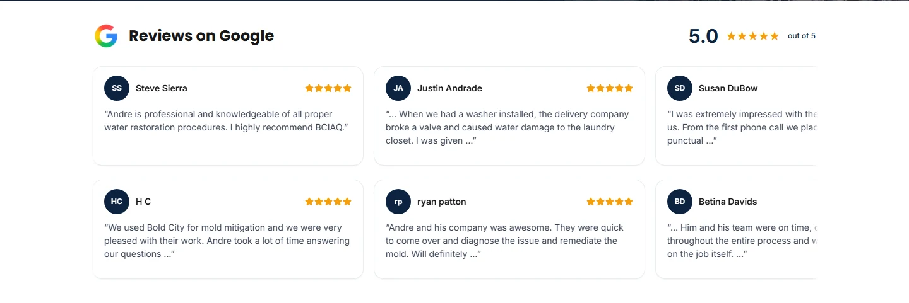

# Final release preparation — November 8, 2026

**GO for draft/preview review; NO-GO for production or GTM publication.** Continued from fetched remote/local head `3679b06e849d8625572151b5c713facb2e860950`, on `codex/website-seo-revamp`, [existing draft PR #1](https://github.com/saybenn/BoldCity2025/pull/1). No production deployment, merge, GTM publication, live GA4 setting change, account reactivation, new lead or email occurred.

[Exact changed-file manifest](changed-files.txt) · [Validation summary](validation-summary.json) · [53 preserved source files, normalized-LF SHA-256 audit](preserved-source-audit.json). The audit confirms the existing pages, analytics, deployment/preview controls, review records, schema/config and form/edge code remain unchanged from the fetched baseline. Only the carousel/avatar presentation and focused tests/docs are edited.

## Implementation and real photo count

**0 genuine reviewer profile photos verified or rendered.** The owner answered **“no”** to an existing approved GBP API project/connection or owner export. No authorized Places API response was available. The image-capable UI is implemented; an authorized source/delivery adapter is pending. This is not a claim that the reviewers have no Google pictures.

- Added a verified-metadata boundary and 40px circular, fixed-space, lazy, cover-image renderer. Exact HTTPS Google image host restriction; no optimizer cache, local portrait copies, client API requests or exposed OAuth credentials. Missing, rejected, failed and expired metadata/images use initials.
- Kept all 23 source records and the 22 written-review names, ratings, excerpts and order unchanged. Adjusted vertical padding to preserve compact geometry. Current cards contain no links or new buttons; verified future API-required source access uses avatar/name only, never repetitive bottom links. Existing motion, keyboard access, focus-only pause control, reduced motion, hidden scrollbars and inert repeats remain.
- [All 23 record matches/statuses](avatar-match-report.json) · [Source, policy, attribution, validation and future delivery contract](avatar-source-contract.md). No uncertain identity was assigned an image.

## Current and historical verification, kept separate

| Category | Result and scope |
| --- | --- |
| **Implemented** | Avatar component/helper, optional carousel metadata, compact styling, tests, per-record source report and controlled release runbook. No homepage data feed is enabled. |
| **Verified live, Nov 8** | The user's account link opens cancelled Google Ads customer **552-921-2374**. Lead Submit's GTM setup panel shows the **exact ID 10940863332 and label x_PWCO3DlYkbEOSmgeEo**. Primary / One conversion / account-default Submit lead form / data-driven Google paid channels. Ownership resolved; account still cancelled, awaiting conversions, Enhanced Conversions setup issues. [Detailed evidence and limits](ads-account-verification.json). No account setting saved. |
| **Verified in isolated QA, Nov 8** | Production build, TypeScript, 21 unit tests, lint 0 errors/9 existing warnings, 10 focused production-build Chrome checks plus separate opt-in mocked-image fixture. Six widths, original review integrity, no overflow, reserved 40px image geometry, no broken-image UI, keyboard/motion/reduced motion and no accessible repeats. Real localhost GTM script loaded HTTP 200; app events correct and collection blocked. |
| **Account configuration saved but unpublished, Nov 7** | GTM workspace 4's accepted-only native Ads 52/Google Ads destination 53, disabled automatic user-provided-data collection, lead compatibility lookups 56–58 and original event mappings are preserved. Last exported audit: 49 pending changes. No GTM configuration edit this pass. |
| **Prior live evidence, Nov 6** | One genuine selected-preview lead accepted and Postmark delivered to the previously authorized test recipient; production test-recipient removal was saved. [Exact old evidence](../trust-final/live-accepted.json). No new live submit or mail repeated. Genuine replay and exactly-once analytics were not captured in that session. |
| **Prior account/debug evidence, Nov 7** | Actual published GTM version 3/Version 2, Aug 28 2025; GA4 history switches both enabled. Actual unpublished Tag Assistant session: app page_view 2, tag pageview attributions 3, phone 1, CTA 1, both lead tags 0. [Raw event IDs/configuration](../gtm-publication/event-trace.json). No passing post-switch Tag Assistant result or actual GA4/Ads delivery claimed. |
| **Pending owner action** | Authorized photo source if genuine faces are required; cancelled Ads account intent/remediation and Enhanced Conversions diagnosis; effective linker/consent/campaign qualification; live accepted-once/replay/notification/runtime checks; full GTM deletion review; separate coordinated release approval. |

The initial browser extension account connection timed out. Windows native read-only access then recovered the Ads inspection and exact conversion match. A later attempt to read the GTM tab was stopped by Computer Use because the current Chrome URL could not be identified confidently. Account automation ended there; no alternate method was used to bypass the stop. Current GTM/GA4 configuration evidence is therefore explicitly **dated November 7**, not represented as a fresh November 8 account audit.

Ads inventory with **Status All** showed nine actions: seven enabled and two removed website/page-load actions. No second enabled website or GA4-import action appeared in this account. Call/direction actions remain valid business paths and were untouched. This does not prove transport deduplication, exclude another account or qualify future campaign goal choices. Goal Summary displayed 0 of 0 campaigns; historical report date Sep 17, 2025 was not changed, and zero conversion totals were not used to infer current receipt. Ads **One** is not server-side exactly-once enforcement.

## Responsive and browser evidence

Final screenshots are from the **actual local production build**, not a design mockup. Mobile is Chrome viewport emulation, not a physical device. They intentionally show initials because no real photo source was verified.

| Width | Card width × height | Section height | Page overflow |
| --- | --- | --- | --- |
| 320 | 276 × 181 | 351 | None |
| 375 | 331 × 160 | 330 | None |
| 430 | 380 × 139 | 309 | None |
| 768 | 360 × 164 | 486 | None |
| 1024 | 360 × 164 | 486 | None |
| 1440 | 430 × 158 | 480 | None |

All cards remain wider than tall. Section heights match the prior implementation at 375–1440px and are 8px shorter at 320px. No always-visible control or native scrollbar. The existing keyboard-focus-only pause/resume remains for accessibility; there are no pointer slider controls.

[All six screenshots and measurements](reviews) · [Production browser results: 10/10](production-browser-results.json) · [Mocked avatar fixture: 1/1 final](avatar-fixture-final-results.json) · [Mock image/load geometry evidence](avatar-fixture.json).

The fixture uses a small solid-color PNG, **not a customer photo**, and aborts a broken image request. It verifies loading space, 40px dimensions, lazy/no-referrer/cover rendering and missing/failure/rejected fallback without layout shift. Unit tests check exact identity/source/URL/size/attribution/expiry rejection. The real homepage test sees 44 initials, no portrait requests, 22 semantic reviews and 22 inert repeats. These tests do not qualify a real Google photo URL, network payload or identity.

## Regression results and retries

- `npm test`: **21/21** passed (18 existing plus 3 avatar contract tests), including existing deployment/preview and mocked form/provider behavior. No real notification sent.
- `npm run typecheck`: PASS. [Output](typecheck-results.txt).
- `npm run lint`: **0 errors, 9 existing warnings**; no new avatar warning. Existing form effect/legacy image/hook warnings remain outside scope.
- `npm run build`: PASS in a fresh isolated `.next-release-prep` output directory with unchanged build config, network access for existing Google Fonts, local deployment context and GTM suppressed. [Output](build-results.txt). 39 generated pages; no `__review_avatar_qa` route. The temporary output directory was cleaned after tests.
- Focused local production Chrome suite: **10/10** passed. Six responsive geometry/keyboard checks, desktop/mobile motion, local tracking isolation and original-record/accessible-repeat integrity. The independent development fixture: **1/1** passed after explicitly opting in.
- Existing isolated GTM QA profile: actual Chrome with GTM blocked and real GTM loaded **both passed**. One initial plus one client route `page_view`, phone 1, CTA 1, lead 0, **zero collectors past CSP**. [Current result](gtm/local-browser.json). This loads the public GTM script, not the unpublished Preview workspace; it does **not** retest draft firing counts or prove receipt. No source/event changes were needed.

Initial development main run was 10 pass / 1 fail: the fixture's whole-page accessible-image assertion included development tooling outside its `<main>`. Scoped it to the fixture main (no application relaxation); focused retry passed, as did the final explicitly opted-in run. [Original result retained](browser-results.json), [first retry](avatar-fixture-results.json). The fixture test now skips by default unless `QA_AVATAR_FIXTURE=true`, preventing the normal production suite from requiring an unshipped QA route.

Build/test environment retries are documented rather than hidden: sandbox font download failed; a cached Turbopack CSS worker then exited before connecting, including a serialized retry. A clean output directory resolved the build. The first GTM browser attempt was sandbox network-denied, followed by a loopback timeout; restarting the same QA server with network permission and rerunning the same guarded script passed. No verification, CSP, form or production setting was weakened.

To reproduce the fixture, copy `tests/fixtures/reviewer-avatar-qa.jsx` to `pages/__review_avatar_qa.jsx`, run a local **development** server with `QA_AVATAR_FIXTURE=true`, local provider/context, GTM QA disabled and widget key blank. Set `QA_BASE_URL` and **QA_AVATAR_FIXTURE=true in the test runner too**, then run `playwright test reviewer-avatars.spec.cjs --grep 'isolated avatar fixture'`. Stop the server and remove the temporary page before build/commit. The committed fixture stays outside `pages`; it is never deployed. Keep official Turnstile dummy-key tests in their separate existing profile; none were needed or altered in this avatar pass.

## Release gates and exact next steps

The [ordered launch runbook](launch-runbook.md) includes preflight, real production rollback/deploy references, fresh published/draft exports, owner approval, website deployment, the **specific GA4 history switch**, reviewed GTM publication, clean debugger/DebugView tests, separately authorized genuine lead/replay/delivery/counting, consent/Ads checks and three-system rollback. It identifies the non-atomic tracking interval and browser-cache propagation; no zero-gap/backfill promise.

| Gate | Current status |
| --- | --- |
| Ads ID/label ownership | **Verified live Nov 8**; correct action/account found |
| Ads account operation and campaign readiness | **Blocked**: cancelled account, owner intent/remediation and Enhanced Conversions diagnostic unresolved |
| Native accepted-lead choice and reporting | Owner approved strategy; draft 52/53 and lookups preserved, actual linker/consent/delivery/counting pending |
| GA4 automatic history switch | Approved **only at cutover**; deliberately unchanged now; failing 3 vs 2 debugger result remains a release gate |
| Published GTM replacement/deletions | Full reviewed version/backup/final clean acceptance pending; old 8/10/16/17/19 deletions need deliberate parity/reporting review |
| Real accepted-lead exactly-once / token replay | **Pending**: isolated/mocked tests pass; real successful preview did not capture these checks |
| Production recipient/notification config | Prior saved configuration/source guards documented; current context, production secret pairing/notification/confirmation qualification pending; no production lead sent |
| Netlify edge/rate-limit runtime | Existing trusted-IP/fail-closed source and partial live 429/header evidence retained; owner rule attachment/log/runtime/method/alias acceptance pending |
| Preview noindex/tracking isolation | Source and local tests preserved; final PR preview check status is reported separately, not assumed from the prior head |
| Genuine review avatars | **0 verified/rendered**; authorized source and server delivery integration pending; safe fallback implemented |
| GA4/Ads real receipt or accepted-conversion counting | **Not verified this pass**; QA collection intentionally blocked |
| Merge/deploy/GTM publication | **Not authorized and not performed** |

Plain English: the review cards have safe places for real faces, but we do not have permissioned photos yet, so they still show letters. We found the right ad counter, but its account is switched off. The launch checklist says when to turn off Google's extra page counter and how to undo the release if something goes wrong. Nothing has been launched.
