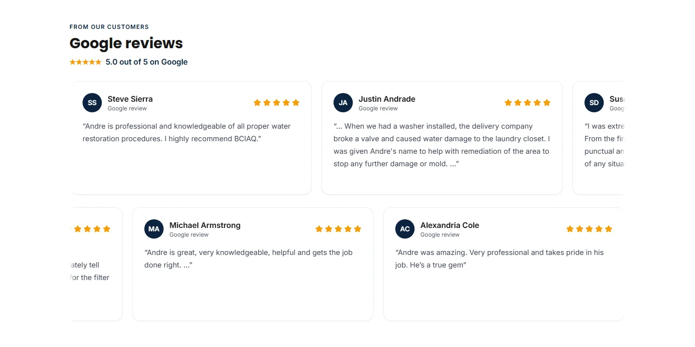
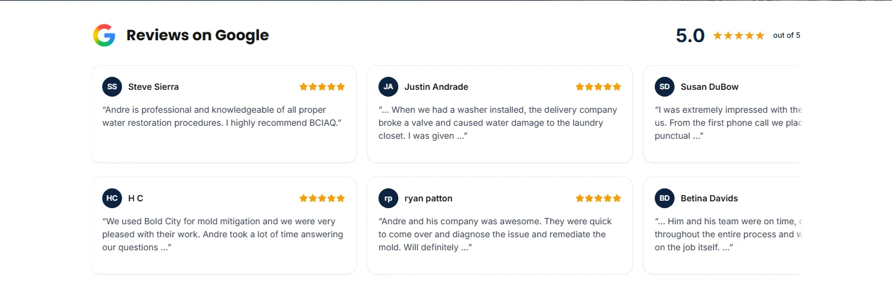

# Trust section and integration handoff — November 6, 2026

Existing draft PR [#1](https://github.com/saybenn/BoldCity2025/pull/1), branch `codex/website-seo-revamp`. Baseline `14405261d6cc422e771dad2f434266f1692e4bf4`; application changes `cdd87d292aa770ba59288d52ff6268171742d12e`. Later changes in this phase are verification helpers, documentation and evidence. Timestamps after midnight UTC correspond to November 6 in America/New_York.

**GO for preview review; NO-GO for production.** The code/UI checks pass, one genuine selected-preview notification was accepted and delivered, and GTM mappings are saved as unpublished drafts. Genuine spent-token replay, live accepted-lead event counting, production pairing/delivery, GA4/Ads/consent qualification and remaining owner-only Netlify protection checks are not all verified. No merge, production deploy, widget creation/rotation or GTM publication occurred.

## Implemented code

- The Google review section is 480px tall at 1440px, down from 720px; at 375px it is 330px, down from 450px. It uses the officially sourced Google G, retained genuine 5.0 source rating, initials, names, five stars and concise verbatim excerpts. All 22 written source records remain unchanged; no unverified total, dates or reviewer photos were added. In-card links, repeated “Google review” subtitles, the rating-check line and attribution/disclaimer boilerplate are absent.
- Rectangular panels flow at a subtle native scroll speed on desktop and mobile. Hover does not pause. Touch/inertia and keyboard focus pause without fighting the user; Escape holds pause and a focus-only accessible pause/resume button is available. There are no persistently visible buttons, arrows, tracks, scrollbars or indicators. Reduced motion disables autoplay, and offscreen/hidden-page animation is cancelled. Decorative loop repeats are inert and aria-hidden; each genuine review has one accessible original.
- The duplicated protected-kitchen worker frame is removed from the work gallery and retained in the service backdrop. The inspected `moldSigue.webp` replacement is labeled **Air-handling equipment and protected cabinets** with factual alt text. It does not assert separate jobs, species, measurements or completed results. Comparison/lightbox behavior is retained. Nine distinct homepage photographs passed source/fingerprint checks and visual contact-sheet inspection.
- Production lead recipients are normalized, deduplicated and filtered against Saybencodes Gmail aliases (dots, plus tags, case and googlemail spelling), with fail-closed behavior if no permitted inbox remains. Preview routing remains a single explicit test recipient, with no business fallback. No additional CC/BCC or notification path was introduced.
- The existing Turnstile wrapper chooses the official compact size in form columns narrower than 300px, preventing 320px overflow. Existing Pages Router rendering, `/api/contact`, delegated `/api/lead`, trusted Netlify IP, rate limits and exact hostname/action Siteverify binding remain intact.
- Accepted-lead analytics clear omitted optional form-name/service values to null so GTM cannot retain a previous form's values. The standardized single data-layer transport remains; no legacy event or duplicate gtag/Ads transport was added.

Application files: `components/ReviewsCarousel.js`, `components/BeforeAfterSlider.jsx`, `components/contact/TurnstileField.tsx`, `styles/globals.css`, `lib/review-presentation.js`, `lib/analytics.ts`, `pages/api/contact.ts`, `public/images/brands/google-g.png`. Tests, validators, the UI registry, provenance and reports are listed in [the exact phase file manifest](changed-files.txt).

## Live integrations and account changes

| Check | Observed result | Limit |
| --- | --- | --- |
| Existing widget / selected-preview key | Supplied public key matched Cloudflare, Netlify contexts and deployed public JavaScript; selected preview and both canonical hosts are authorized | Secret presence inspected masked; no secret recovery/getter/write/rotation; production pairing not exercised |
| Genuine selected-preview contact | One labeled `BCIAQ-QA-1794020598758` submission reached “Request received” through the unchanged secured handler | Raw HTTP response not captured in the successful regular-browser UI session |
| Postmark | Matching message `9c7e0ecf-2385-486c-8c95-e9b7bb97bd7b`, processed 22:05:51 and delivered 22:05:53 Eastern to the approved preview inbox; QA ID matched in body | SMTP delivery proves recipient-server acceptance, not reading; no production submission made |
| Replay and live lead-event count | **Not verified live** | Automated Chrome challenge failed; successful regular-browser session did not capture spent token or expose main-page analytics state to read-only inspection. No second email sent. Mocked checks are reported separately |
| Production recipient configuration | Existing business inbox retained, no project backup variable found; production test-recipient value emptied and save verified | New code guard remains a PR change until release; dashboard state does not prove current production runtime reloaded it |
| GTM | Four triggers/four event tags and Base updated manually, five variables added; actual export compared exactly, firing/consent/destination preserved | Unpublished draft only; full published container, GA4 stream and Ads conversion configuration unqualified |
| Both hosted previews | HTTP 200, noindex headers/meta, 22 semantic reviews, hidden scrollbars, no page overflow at desktop/mobile, **zero production Google tracking requests**, without intercepting tracking | Secondary project has different form configuration and no matching widget-host authorization; no form test there |

Evidence: [live submission/delivery](live-accepted.json), [real GET-only preview checks](live-previews.json), [blocked automated attempt](automated-form-attempt.json), [account observations](account-configuration.json), [actual GTM export comparison](gtm-migration.json), [exact owner steps and launch gates](owner-actions.md).

The old 110200 diagnosis and unavailable-account instructions are historical. Current selected-preview hostname authorization and genuine delivery are verified. The existing-widget recovery documentation was read; secret recovery was unnecessary because secrets were already configured. No guarded secret getter or recovery manifest execution is claimed.

## Tests and scope

| Validation | Result | Scope |
| --- | --- | --- |
| Production build | PASS | Next build and build-time TypeScript; [output](build-results.txt) |
| Standalone TypeScript | PASS | `npm run typecheck` on the final application implementation |
| Unit tests | **17 PASS** | Recipient filtering/isolation, analytics allowlist/clearing, schema, verification/error cases; network providers mocked; [output](unit-results.txt) |
| Full ESLint | **0 errors, 9 warnings** | Existing warning classes retained; final helper included; [report](lint-results.json) |
| Full Chrome suite | **27 PASS, 0 flaky/skipped** | Real local Chrome rendering/navigation/accessibility/analytics behavior, including six widths and prior services/parallax regressions; provider/API success/error paths explicitly mocked where used; [report](browser-results.json) |
| Route/schema/image validation | **37 routes, 28 assets, 0 issues** | Real local rendered HTTP output; [report](site-validation.json), [page matrix](page-matrix.md), [schema](schema-validation.md) |
| Homepage media uniqueness | **9 photographs, no likely duplicate source frame** | Decoded source fingerprints and manual visual inspection; [report](media-validation.json), [contact sheet](media-contact-sheet.webp) |
| Desktop/mobile motion record | PASS | Actual rendered Chrome recordings, timing samples, seamless boundary check, keyboard pause and reduced motion; mobile native CDP touch/inertia/resumption, not a physical phone; [measurements](motion/verification.json) |
| Hosted checks | PASS for layout/noindex/tracking | Actual external Chrome/HTTP, no mocked challenge/Siteverify/Postmark or tracking interception; no email in GET-only mode |
| Genuine integration | PARTIAL | One selected-preview lead + Postmark delivery pass; live replay/event counting and production qualification remain open |

No actual GA4/Ads delivery was inferred from a local data-layer test. Read-only inspection after the genuine submission returned zero accessible `generate_lead` events. Main-page event state and the cause of that result were not established, so this is an unresolved live-count check, not a pass. Safari, Firefox, physical-device rendering and field Core Web Vitals were not measured.

## Responsive measurements and screenshots

| Viewport | Section height | Card width | Card height range | Page overflow |
| --- | --- | --- | --- | --- |
| 320 | 359 | 276 | 189 | None |
| 375 | 330 | 331 | 160 | None |
| 430 | 309 | 380 | 139 | None |
| 768 | 486 | 360 | 158–164 | None |
| 1024 | 486 | 360 | 158–164 | None |
| 1440 | 480 | 430 | 158 | None |

Every card is wider than tall. Each width has [an exact JSON measurement and capture](reviews/). Hosted screenshots independently confirm the same 480/330 desktop/mobile heights.

| Review section | Baseline | After |
| --- | --- | --- |
| Desktop 1440 |  |  |
| Mobile 375 |  |  |

[Desktop motion video](motion/reviews-1440.webm) · [Mobile autoplay/swipe video](motion/reviews-375.webm) · [Hosted desktop](hosted-selected-1440.webp) · [Hosted mobile](hosted-selected-375.webp) · [Prior service-photo regression captures](services/)

Account proof: [GTM Base draft](accounts/gtm-draft-base.jpg), [accepted-lead draft](accounts/gtm-draft-generate-lead.jpg), [production/preview recipient contexts](accounts/netlify-recipient-contexts.jpg), [matched Postmark delivery](accounts/postmark-preview-delivered.jpg). Captures show the test message only; no secret values or unrelated customer message bodies are committed. The successful preview tab remains open for the main-page event-count check described in owner actions.

## Reproduction and release decision

Run `npm run build`, `npm run typecheck`, `npm test`, `npm run lint`, `npm run test:browser`, then the site/media validators against the local production server. `scripts/check-trust-integrations.cjs` defaults to GET-only hosted checks. Its `--submit` mode is explicitly side-effectful and now refuses when the recorded approved submission already exists. Do not delete that evidence to send an unauthorized extra lead. `scripts/record-trust-motion.cjs` records actual local Chrome movement.

Keep this PR a draft. See [owner actions](owner-actions.md) for GTM's complete 42-change workspace review, GA4 automatic/history/form measurements, consent, Ads deduplication, real replay/event-count capture, Netlify rule/runtime checks, production configuration qualification and separate release approval. Existing service/local architecture, SEO, schema, authentic source records, security and preview protections are retained.

Plain English: the reviews now look like short, wide cards that glide across the page. One practice message reached the test mailbox. We still need to check the real counting rules and make sure an old robot-check pass cannot work twice before launching.
